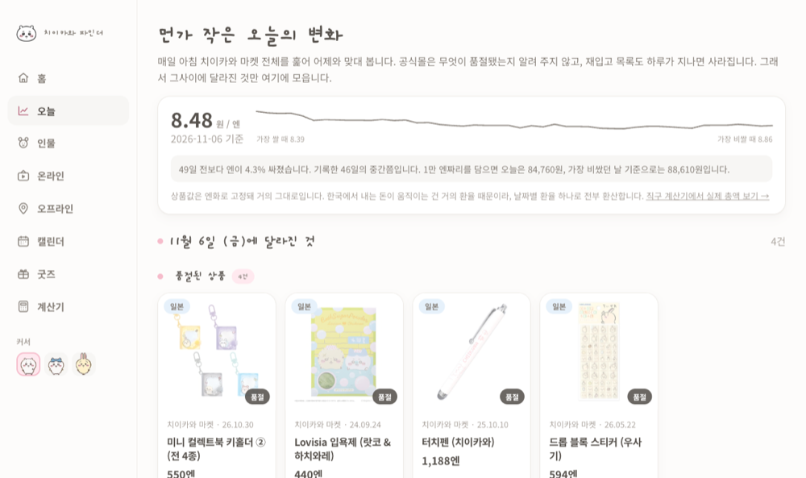
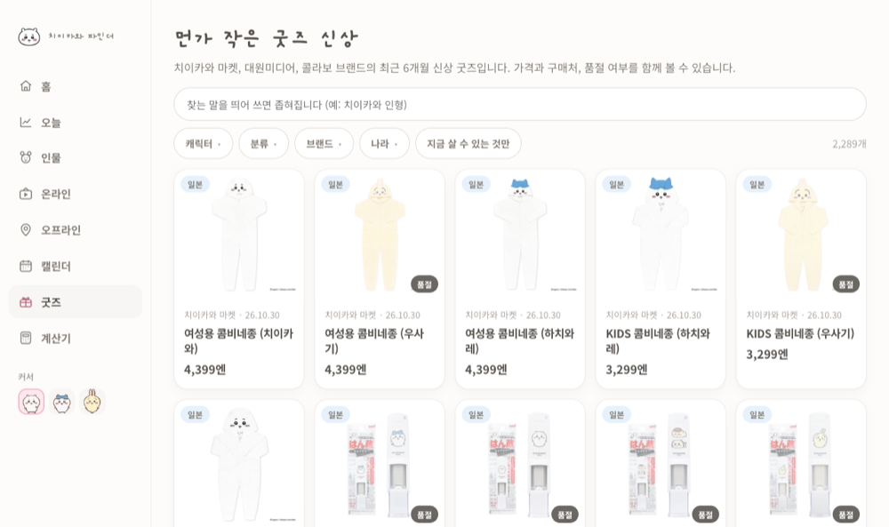
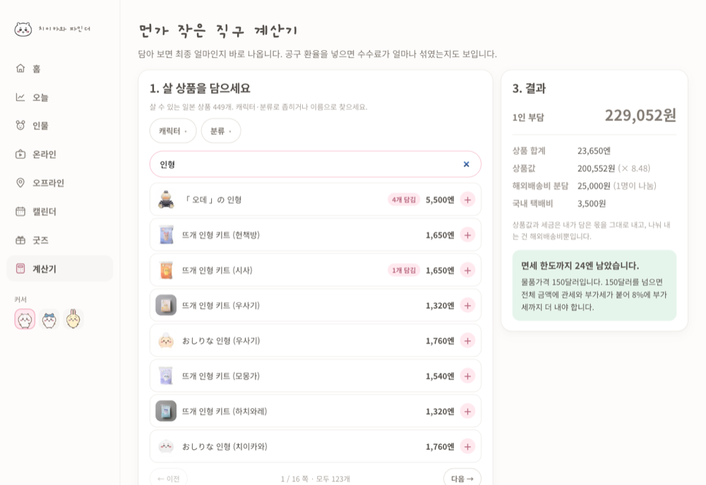

# 치이카와 파인더

> 치이카와 굿즈를 **지금 살지, 기다릴지, 원화로 얼마인지** 정하게 돕는 사이트.
> 막 입문한 팬이 작품·온라인·오프라인 정보를 한 곳에서 보는 곳이기도 합니다.

### → **[chiikawa-finder.vercel.app](https://chiikawa-finder.vercel.app/)**



<br>

## 무슨 문제를 푸나

파는 곳은 일본 공식몰입니다. 한국 팬 입장에서 벽이 셋 있습니다.

- 어제와 **뭐가 달라졌는지 알려 주지 않는다**
- 상품명이 **전부 일본어다**
- 가격이 **엔화다**

커뮤니티에서 불편의 빈도를 세어 보니 1위가 품절·재입고 시점을 모르는 것이었습니다.
그런데 그 커뮤니티 공지는 시세·구매처·재고·가품 질문을 전부 금지하고 있었습니다.

**수요가 가장 큰 정보일수록 물어볼 곳이 없었습니다.** → [조사 원문](docs/user-needs.md)

<br>

## 누가 쓰나

| | 먼저 묻는 것 | 보는 화면 |
|---|---|---|
| **이미 사고 있는 팬** | 오늘 뭐가 품절됐나 · 또 들어오나 · 얼마인가 | 오늘 · 굿즈 · 캘린더 · 계산기 |
| **막 입문한 팬** | 뭘 봐야 하나 · 어디서 보나 · 어디 가면 되나 | 인물 · 온라인 · 오프라인 |

<br>

## 무엇을 하나



**매일 바뀌는 쪽** — 공식몰을 매일 긁어 어제와 비교합니다.

- `/today` 어제와 비교한 신상 · 품절 · 재입고
- `/goods` 굿즈 2,289건. 한국어 검색 + 캐릭터 · 분류 · 브랜드 · 나라 필터
- `/goods/[id]` 재입고 타임라인과 평균 주기, 원화 추이
- `/calendar` 앞으로 나올 것과 최근 다시 들어온 것

**고정 정보 쪽** — 흩어져 있던 것을 한 번 모아 둡니다.

- `/characters` 인물 45명, 등장 에피소드 584건
- `/online` 만화 · 애니 · 영상 · SNS 등 볼 수 있는 경로 78건
- `/offline` 팝업 · 매장 81곳(진행 중 40곳). 지도와 진행 상태
- `/offline/course` 하루에 도는 순서. 1.8km 넘으면 "걷지 말고 전철"

<br>

## 직구 계산기



담으면 최종 금액이 나옵니다. 다른 곳에 없는 건 둘입니다.

**공구 환율에 섞인 수수료**
공구 모집글은 수수료를 따로 적지 않고 "엔당 9.5원" 같은 적용 환율에 넣습니다.
실환율과 나란히 두면 그 차액이 원 단위로 드러납니다.

**면세 한도의 비대칭**
일본발은 물품가격 150달러를 넘으면 초과분이 아니라 **전체 금액**에 관세와 부가세가 붙습니다.
한도 판정에는 국제운임을 빼지만, 실제 과세가격에는 들어갑니다. → [계산 근거](docs/import-cost.md)

<br>

## 일부러 안 만든 것

**가품 판별** — 조사 2위였지만 뺐습니다.
판정이 틀리면 사용자가 금전 피해를 보는데, 판정할 근거 데이터가 없습니다.

**개별 공구 모집글** — 트래픽이 가장 잘 나오지만 뺐습니다.
검증 없이 올리면 사이트가 송금을 유도하는 통로가 됩니다. 플랫폼과 결제 보호 수준만 싣습니다.

**제휴 수익** — 굿즈에 `affiliateUrl` 을 두고 값이 있을 때만 그쪽으로 보냅니다.
다만 상품 대부분이 올라오는 치이카와 마켓은 제휴 프로그램이 없어, 지금 구조로는 수익이 거의 나지 않습니다.
→ [수익화 조사](docs/monetization.md) · [볼 지표](docs/metrics.md)

<br>

## 실행

```bash
pnpm install
pnpm dev      # 개발 서버
pnpm build    # out/ 에 정적 사이트 생성
pnpm check    # 테스트 108개 (node --test)
pnpm scrape   # 굿즈 수집
pnpm fx       # 환율 갱신
```

Node 24 이상이 필요합니다. 테스트가 TypeScript 를 그대로 실행합니다.

<br>

## 구조

데이터는 전부 JSON 파일이고, 매일 06:00 KST 에 GitHub Actions 가 갱신합니다.

| 경로 | 내용 | 규모 |
|---|---|---|
| `src/data/goods.json` | 최근 6개월 굿즈. `cm-` 은 수집기, 나머지는 수동 | 2,289건 |
| `src/data/history.json` | 날짜별 신상 · 품절 · 재입고 id 와 그날 환율 | 46일 |
| `src/data/characters.json` | 인물 프로필과 등장 에피소드 | 45명 |
| `src/data/places.json` | 한국 · 일본 팝업 · 매장 (위경도 포함) | 81곳 |
| `src/lib/goods-name.ts` | 일본어 상품명 → 한국어 | 사전 795항목 |
| `src/lib/search.ts` | 검색. 한국어 ↔ 일본어 별칭을 잇는다 | |
| `src/lib/cost.ts` | 직구 비용 · 면세 한도 판정 | |
| `scripts/scrape.mjs` | 공식몰 전량 수집 | |
| `scripts/history.mjs` | 어제 파일과 비교해 그날의 변화를 뽑음 | |

<br>

## 더 보기

| 문서 | 내용 |
|---|---|
| [기획 문서](docs/planning/README.md) | 시장조사 · 기획서 · 요구사항 · 정책 · 화면설계 · 지표 · 운영 · 셀프 리뷰 |
| [구현 메모](docs/implementation.md) | 파이프라인 설계, 이미지 · 커서 생성, 디자인 |
| [커뮤니티 조사](docs/user-needs.md) | 불편 빈도 조사. 인용과 링크 원문 |
| [직구 비용](docs/import-cost.md) | 관세 · 부가세 · 면세 한도 근거와 출처 |
| [수익화](docs/monetization.md) | 제휴 · 공구 조사와 그은 선 |
| [지표](docs/metrics.md) | 볼 지표와 이벤트 정의 |
| [검색엔진 등록](docs/search-console.md) | 절차와 막혔던 지점 |
