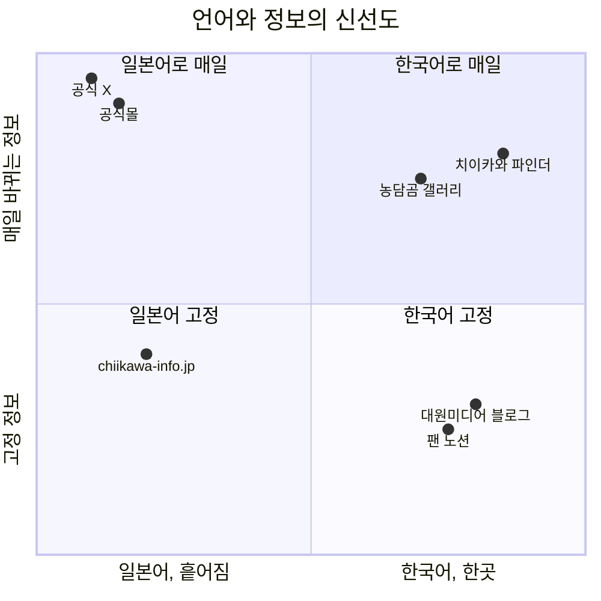

# 1. 사전 시장조사

> **결론:** 들어갈 이유가 있다. 치이카와는 일본 캐릭터 대상 3연패에 한국에서도 극장판 258만 관객, 유통가 캐릭터 콜라보 긍정 반응 1위인 IP인데, 한국 팬이 가장 많이 묻는 "오늘 뭐가 품절됐나, 다시 들어오나, 원화로 얼마인가"에 답하는 곳이 없다. 메인 커뮤니티는 그 질문을 공지로 금지하고, 공식 정보 사이트는 일본어뿐이며, 한국 유통사는 문의에 답하지 않는다. 다만 상품 대부분이 올라오는 공식몰에 제휴 프로그램이 없어 수익은 거의 나지 않는 구조다. 비용 0으로 작게 운영하며 검색 유입을 본다.

조사 시점: 2026-11-11. 커뮤니티 조사 원문은 [docs/user-needs.md](../user-needs.md)(2026-09-17), 수익화 조사 원문은 [docs/monetization.md](../monetization.md)(2026-09-16)에 있다.

---

## 1. 시장 배경

| 시장 신호 | 수치 | 출처, 시점 |
|---|---|---|
| 일본 캐릭터 비즈니스 시장 | 2025년도 2조 8,767억 엔(전년 대비 103.2%), 2026년도 2조 9,635억 엔 예측 | [KAI-YOU](https://kai-you.net/article/96003), 2026-07-17, 야노경제연구소 발표 인용 |
| 일본 캐릭터 상품 소매 시장 | 2024년 1조 6,860억 엔, 2015년 이후 최고 | [SBbit](https://www.sbbit.jp/article/cont1/185096), 2026-04-25, 캐릭터·데이터뱅크 조사 인용 |
| 치이카와의 위상(일본) | 일본 캐릭터 대상 사상 첫 3연패 | KAI-YOU, 위와 같음 |
| 치이카와의 위상(한국) | 유통가 캐릭터 콜라보 소셜 빅데이터에서 먼작귀 긍정 반응 비율 2024년 83.4%, 2025년 83.5%로 2년 연속 1위 | [MTN](https://news.mtn.co.kr/news-detail/2026081401031550160), 2026-08-14, 뉴엔AI와 공동 분석(2024-01~2026-07) |
| 극장판(한국) | 2026-09-30 개봉, 10-25 기준 누적 225만 명, 박스오피스 3주 연속 1위 | [이코노미스트](https://economist.co.kr/article/view/ecn202610260020), 2026-10-26 |
| 극장판(한국, 최신) | 11-01 기준 누적 258만 3,857명, 그날 1위 | [인사이트](https://www.insight.co.kr/news/580249), 2026-11-02 |
| 극장판(일본) | 흥행 수입 170억 엔, 관객 1,100만 명 | 이코노미스트, 위와 같음 |
| 극장 굿즈 수요 | 팝콘통 2만 9,000원이 3차 예약까지 매진, 특전은 상영 1~3회차에 품절, 굿즈 2~3개면 10만 원 | 이코노미스트, 위와 같음 |
| 팝업 대기 | 용산 매지컬 치이카와 팝업, 대기 100팀 이상, 오후 2~3시에 접수해 저녁 7시 넘어 입장, 네이버 예약은 모든 시간대 매진 | [위키트리](https://www.wikitree.co.kr/articles/1146569), 2026-07-16 |
| 한국 콘텐츠 산업 | 2025년 매출 161조 4,839억 원(+2.6%), 수출 149억 달러(+5.9%), 캐릭터 수출 +12.8% | [아주경제](https://www.ajunews.com/view/20260430092423101), 2026-04-30, 콘진원 발표 인용 |
| 한국 공식 유통 | 대원미디어. 용산 아이파크몰에 치이카와샵 정규 매장 2026-02-27 개점 | [수익화 조사](../monetization.md) |
| 공식몰 해외 구매 경로 | 치이카와 마켓의 해외 배송 대행(WorldShopping) 2025-12-15 종료 | [커뮤니티 조사 7-1](../user-needs.md#7-1-직구-경로-선택-배대지-vs-직배송--매번-다시-계산해야-함) |

읽는 법은 이렇다. IP의 힘은 숫자로 확인된다. 한국에서도 극장판이 258만 명을 모았고 굿즈는 회차 단위로 품절된다. 그런데 한국 팬이 굿즈를 사는 길은 일본 공식몰 직구와 공구가 중심이고, 공식 대행 서비스가 없어진 뒤로는 팬이 환율·배송비·세금을 매번 스스로 계산한다. 수요는 크고, 정보는 일본어로 흩어져 있다.

## 2. 이용자

치이카와 굿즈를 사려는 한국 팬이다. 둘로 나뉜다.

| 구분 | 이미 사고 있는 팬 | 막 입문한 팬 |
|---|---|---|
| 상황 | 공식몰을 매일 새로고침하고, 재입고 소식을 커뮤니티 속보로 안다 | 극장판이나 SNS로 알게 됐는데 뭘 봐야 하고 어디서 사야 하는지 모른다 |
| 먼저 묻는 것 | 오늘 뭐가 품절됐나, 또 들어오나, 원화로 얼마인가 | 뭘 봐야 하나, 어디서 보나, 어디 가면 되나 |
| 걱정 | 결제 순간 품절, 공구 수수료가 얼마나 숨었나, 세금이 붙나 | 일본어 상품명, 가품, 커뮤니티 은어 |
| 파인더의 답 | 오늘의 변화, 굿즈 검색, 재입고 주기, 직구 계산기 | 인물, 온라인(어디서 보나), 오프라인 지도, 토벌 코스 |

이용자가 하려는 일(jobs)은 다섯 가지로 좁혔다. 어제와 뭐가 달라졌는지 알기, 한국어로 찾기, 원화로 얼마인지 알기, 기다릴지 정하기(재입고 주기), 어디 가면 되는지 알기.

커뮤니티에서 불편의 빈도를 세어 본 결과는 이렇다. 디시인사이드 농담곰 마이너 갤러리 제목·본문 검색 1~3페이지 실측이고, 58건은 3페이지 상한에 걸린 값이라 실제로는 더 많다.

| 순위 | 불편 | 근거 글 수 | 팬들의 현재 대응 |
|---|---|---|---|
| 1 | 품절·재입고 시점을 모름 | 품절 58+, 재입고 58+ | 공홈 무한 새로고침, X 공지 눈팅, 갤 속보, 매장 전화 |
| 2 | 정품·가품 구분 불가 | 가품 36, 짭 58+ | 팬 제작 노션(자주 다운), 갤에 사진 올려 묻기(금지) |
| 3 | 팝업 현장 대기 상황을 모름 | 팝업 58+, 웨이팅 51 | 나우웨이팅, 후기 눈팅, "특파원" 중계 |
| 4 | 국내 정발 정보가 느리고 창구가 없음 | 대원 58+, 정발 58+ | 대원미디어 블로그 문의(답 없음), 일본 X 번역 |
| 5 | 직구 경로·배송비 판단 | 배대지 43, 직구 58+ | 갤에 묻기(금지), 매번 재계산 |
| 6 | 시세·리셀 | 되팔 21, 시세 6 | 번장·중나·메루카리 직접 검색(갤은 플랫폼 언급 금지) |
| 7 | 결제 순간 서버 다운 | 서버 15 | 미리 로그인, 바로 결제 같은 구전 노하우 |
| 8 | 쿠지 구성·확률·배송비 | 쿠지 58+ | 일본 팬 계정 번역, 실비 공유글 |

가장 중요한 구조적 발견은 메인 커뮤니티 공지가 시세·구매처·배대지·현장 재고·가품 판별 질문을 전부 금지한다는 것이다. 수요가 가장 큰 정보일수록 물어볼 곳이 없고, 그 질문은 검색으로 흘러나온다.

## 3. 경쟁·대체 서비스

| 서비스 | 무엇을 주나 | 무엇이 없나 | 출처 |
|---|---|---|---|
| chiikawa-info.jp(공식 정보 사이트) | 일본 이벤트·팝업·상설점·콜라보 링크 허브 | 일본어 전용, 한국 매장·정발 정보 없음, 재입고 알림 없음, "지금 살 수 있나"에 답 안 함 | 직접 확인 |
| chiikawamarket.jp(공식몰) | 판매, 재입고 페이지 | 재입고 목록이 전날 숨겨짐, 알림 없음, 결제 순간 서버 다운, 해외 대행 종료 | [99073](https://gall.dcinside.com/mgallery/board/view/?id=nongdamgom&no=99073) |
| 공식 X(@chiikawa_market 등) | 발매·재입고·쿠지 확률 공지 | 한국어 없음. 팬이 번역해 갤에 재업로드 | [98525](https://gall.dcinside.com/mgallery/board/view/?id=nongdamgom&no=98525) |
| 농담곰 마이너 갤러리 | 재입고 속보, 현장 중계, 배송비 실비 공유 | 시세·구매처·재고·가품 질문 금지, 시간순 게시판이라 축적·검색이 안 됨 | [65481](https://gall.dcinside.com/mgallery/board/view/?id=nongdamgom&no=65481) |
| 팬 제작 가품 노션·번역 노션 | 가품 대조표, 원작 번역 | 자주 다운, 1인 운영이라 신상 반영 지연, 번역 노션은 2026-09 연쇄 폐쇄 | [104430](https://gall.dcinside.com/mgallery/board/view/?id=nongdamgom&no=104430) |
| 나우웨이팅, 네이버 예약 | 현장 대기 접수, 일부 팝업 사전예약 | 재고 정보 없음, 입장 방식 변경 안내 없음, 예약 창이 특정 날짜만 열림 | [108274](https://gall.dcinside.com/mgallery/board/view/?id=nongdamgom&no=108274) |
| 대원미디어 블로그 | 국내 발매 공지 | 문의에 답이 없음("에어 게시판") | [108249](https://gall.dcinside.com/mgallery/board/view/?id=nongdamgom&no=108249) |
| 번개장터·중고나라·당근·메루카리 | 중고 거래 | 시세 이력 없음, 정품 검증 없음 | 커뮤니티 조사 4장 |
| 치이카와 파인더 | 공식몰을 매일 긁어 어제와 비교, 한국어 검색, 재입고 주기, 원화 실구매가, 한국·일본 매장 지도 | 가품 판별, 개별 공구, 실시간 재고, 시세 | 이 저장소 |

두 축으로 놓으면 이렇게 보인다. 위치는 위 표를 보고 내가 놓은 것이라 정밀한 값은 아니다.

파인더가 노리는 자리는 "한국어로, 매일"이다. 농담곰 갤러리가 같은 자리에 가깝지만 질문이 금지되고 정보가 흘러간다. 파인더는 질문을 받지 않고 데이터로 답하며, 상품마다 고정 주소가 있어 검색으로 다시 찾아진다.

## 4. 기회와 위험

| 기회 | 근거 |
|---|---|
| 수요 1위 정보를 아무도 주지 않는다 | 품절·재입고가 커뮤니티 불편 1위인데 공식몰은 변화를 알려 주지 않고 재입고 목록을 전날 숨긴다 |
| 커뮤니티가 질문을 금지한다 | 구매처·시세·배대지 질문이 검색으로 나온다. 상품 2천 장이 그 검색의 꼬리가 된다 |
| 공식몰이 Shopify다 | `products.json`으로 전량을 기계로 읽을 수 있다. 태그에 발매일·재입고일이 들어 있다([출처](../../scripts/sources.md)) |
| 상품명이 템플릿이다 | 서로 다른 토큰 1,568개 중 상위 300개가 출현의 71%. 번역 API 없이 사전으로 한국어화가 된다([구현 메모](../implementation.md)) |
| 비용 0 | 정적 사이트, GitHub Actions, Vercel Hobby. 돈이 안 들어 수익 없이도 유지된다 |

| 위험 | 대응 |
|---|---|
| 공식몰 구조 변경·차단으로 수집이 깨진다 | 수집 워크플로에서 테스트를 먼저 돌려 깨진 데이터가 커밋되지 않게 한다. 깨지면 전날 데이터로 서비스는 계속 선다 |
| 저작권·상표 | 비공식 팬 사이트임을 밝히고, 상품 이미지는 공식 CDN 주소를 그대로 쓰며 저장하지 않는다. 권리자가 요청하면 내린다 |
| 가품·공구 사기에 연루된다 | 가품 판별과 개별 공구 게시는 만들지 않는다. 공구는 플랫폼 단위 채널과 결제 보호 수준만 싣는다 |
| 수익이 거의 없다 | 치이카와 마켓은 제휴 프로그램이 없고 한국 상품은 19건뿐이다. 비용을 0으로 두고, 트래픽이 먼저 생기면 쿠팡·네이버 경로를 검토한다 |
| 하루 한 번 확인이라 그사이 변화를 놓친다 | 확인 시각(매일 06:00 KST)을 화면에 적는다. 실시간 재고는 약속하지 않는다 |
| 대원미디어나 공식이 한국어 서비스를 낸다 | 변화 기록(재입고 주기, 원화 추이)은 쌓인 시간이 자산이다. 공식이 생기면 보조 도구로 남긴다 |

## 5. 결론과 범위

들어간다. 범위는 치이카와 마켓 굿즈의 매일 변화와 한국어 검색, 원화 실구매가, 그리고 입문자를 위한 인물·온라인·오프라인 정보. 가품 판별, 개별 공구, 실시간 재고, 시세는 하지 않는다. 성공 여부는 "방문자 중 결정 행동(구매 링크 클릭 또는 계산기 담기)을 한 비율"과 검색 유입으로 본다.

## 출처

- [KAI-YOU, 캐릭터 비즈니스 시장 2026년도 약 3조 엔 전망, 2026-07-17](https://kai-you.net/article/96003)
- [SBbit, 캐릭터 상품 소매 시장 기사, 2026-04-25](https://www.sbbit.jp/article/cont1/185096)
- [MTN, AI 빅데이터로 본 유통가 캐릭터 콜라보, 2026-08-14](https://news.mtn.co.kr/news-detail/2026081401031550160)
- [이코노미스트, 치이카와 열풍에 소비자 지갑 활짝, 2026-10-26](https://economist.co.kr/article/view/ecn202610260020)
- [인사이트, 극장판 치이카와 박스오피스, 2026-11-02](https://www.insight.co.kr/news/580249)
- [위키트리, 치이카와 매지컬 팝업 현장, 2026-07-16](https://www.wikitree.co.kr/articles/1146569)
- [아주경제, 2025년 콘텐츠산업 매출 161조, 2026-04-30](https://www.ajunews.com/view/20260430092423101)
- [커뮤니티 조사 원문](../user-needs.md), [수익화 조사 원문](../monetization.md)
