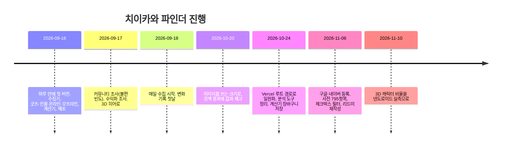

# 2. 서비스 기획서

> **한 줄:** 치이카와 굿즈를 지금 살지, 기다릴지, 원화로 얼마인지 정하게 돕는 무료 웹 사이트. 공식몰을 매일 긁어 어제와 비교하고, 일본어 상품명을 한국어로 바꾸고, 환율과 관부가세까지 더한 실구매가를 계산한다. 막 입문한 팬에게는 인물·볼 곳·갈 곳을 한곳에 모아 준다.

기준일 2026-11-11. 서비스명 치이카와 파인더, 주소 https://chiikawa-finder.vercel.app.

---

## 1. 배경과 문제

치이카와 굿즈는 일본 공식몰(치이카와 마켓)에서 판다. 한국 팬 입장에서 벽이 셋 있다.

| 문제 | 지금 어떻게 되나 |
|---|---|
| 어제와 뭐가 달라졌는지 알려 주지 않는다 | 품절은 조용히 일어나고, 재입고 목록은 재입고 전날 숨겨진다. 팬은 공홈을 새로고침하거나 커뮤니티 속보에 기댄다 |
| 상품명이 전부 일본어다 | "인형"으로 검색하면 한 건도 안 나온다. 번역기로 하나씩 옮긴다 |
| 가격이 엔화다 | 환율, 해외배송비, 공구 수수료, 관세·부가세를 매번 따로 계산한다. 공구는 수수료를 "엔당 9.5원" 같은 적용 환율에 숨긴다 |
| 물어볼 곳이 없다 | 메인 커뮤니티가 시세·구매처·배대지·재고·가품 질문을 공지로 금지한다 |
| 입문 경로가 끊겼다 | 팬 번역 노션이 2026-09에 연쇄 폐쇄됐고, 공식 정보 사이트는 일본어뿐이다 |

## 2. 목표와 목표 아닌 것

| 목표 | 어떻게 재나 |
|---|---|
| 팬이 매일 들어와 어제와 달라진 것을 본다 | /today 재방문, 발매·재입고일 전후 방문 변화 |
| 한국어로 검색해 찾는다 | 검색 결과 0건 비율, 상품명 완전 한국어 비율(69.2%, 2026-11-06) |
| 살지 말지를 사이트 안에서 정한다 | 결정 행동률 = (구매 링크 클릭 + 계산기 담기) ÷ 방문 |
| 검색엔진으로 들어온다 | 구글·네이버 검색 유입 비율, 색인 페이지 수(2,425 제출) |
| 비용이 0이다 | 월 지출 0원 유지 |

목표가 아닌 것: 회원가입, 알림 푸시, 가품 판별, 개별 공구 모집글, 시세, 실시간 재고, 결제·배송 관여, 일본어 외 언어의 상품 수집.

## 3. 타깃

치이카와 굿즈를 사려는 한국 팬. 이미 사고 있는 팬과 막 입문한 팬 둘이다. 자세한 페르소나는 [시장조사 2절](./01-market-research.md#2-이용자).

## 4. 가치 제안

| 이용자가 원하는 것 | 파인더가 주는 것 | 대안과 다른 점 |
|---|---|---|
| 오늘 뭐가 달라졌나 | 매일 06:00 KST 공식몰 전량을 긁어 어제와 비교. 신상·품절·재입고를 날짜별로 | 공식몰은 변화를 알려 주지 않고, 갤러리 속보는 흘러간다 |
| 한국어로 찾기 | 사전 795항목으로 상품명을 한국어로 바꾸고, 한국어↔일본어 별칭으로 검색. 캐릭터·분류·브랜드·나라 필터 | 공식몰은 일본어 검색만 |
| 또 들어오나 | 상품마다 재입고 날짜 전체와 평균 주기, 품절까지 걸린 날 | 아무도 기록하지 않는다 |
| 원화로 얼마인가 | 담으면 실환율 기준 총액. 공구 환율을 넣으면 숨은 수수료가 원 단위로, 면세 한도(150달러)를 넘으면 전체 과세되는 규칙까지 | 블로그 계산법은 흩어져 있고 한도 비대칭을 놓친다 |
| 어디서 보나 | 넷플릭스·라프텔·티빙 등 시즌·더빙·요금 한 표 | 한국 제목이 「먼작귀」라 검색조차 어렵다 |
| 어디 가면 되나 | 한국·일본 팝업·매장 81곳 지도, 진행 상태, 도시별 하루 코스 | 인스타·블로그 후기를 하나씩 읽어야 한다 |

## 5. 핵심 기능과 우선순위

P0는 없으면 서비스가 아닌 것, P1은 첫 출시에 넣은 것, P2는 운영하며 넣은 것이다. 상태는 2026-11-11 기준.

| 우선순위 | 기능 | 설명 | 상태 |
|---|---|---|---|
| P0 | 매일 수집과 변화 기록 | GitHub Actions가 06:00 KST에 공식몰 전량 수집, 어제와 비교해 신상·품절·재입고 id를 history.json에 | 출시됨 |
| P0 | 굿즈 목록과 한국어 검색 | 2,129건, 사전 기반 한국어 이름, 별칭 검색, 4종 필터, 재고 있는 것만 | 출시됨 |
| P0 | 굿즈 상세 | 한국어 이름, 가격, 재고 상태, 재입고 이력, 원화 추이, 구매 링크, 출처 | 출시됨 |
| P0 | 직구 계산기 | 장바구니, 실환율·공구 환율 비교, 무배컷, 해외배송비 분담, 관세·부가세 | 출시됨 |
| P1 | 오늘의 변화 | 최근 하루 변화와 지난 10일 기록, 원/엔 환율 흐름과 판정 | 출시됨 |
| P1 | 발매·재입고 캘린더 | 앞으로 나올 것(발매일별)과 최근 30일 재입고 | 출시됨 |
| P1 | 인물·세계관 | 45명 프로필, 관계, 등장 에피소드 584건 | 출시됨 |
| P1 | 온라인 콘텐츠 | 만화·애니·영상·SNS·게임 78건, 한국에서 되는지, 무료인지 | 출시됨 |
| P1 | 애니 어디서 봐 | 플랫폼별 시즌·더빙·요금 표 | 출시됨 |
| P1 | 오프라인 지도 | 한국·일본 81곳, 유형·나라 필터, 종료 숨기기, 장소 상세와 길찾기 | 출시됨 |
| P2 | 토벌 코스 | 도시별로 가까운 순서, 1.8km 넘으면 전철 안내, 구글 지도 경로 | 출시됨 |
| P2 | 공구 채널 안내 | 플랫폼 5곳의 결제 보호 수준 | 출시됨 |
| P2 | 검색엔진 등록 | 사이트맵 2,425개, 구글·네이버 소유 확인, 상품 구조화 데이터 | 출시됨(11-06) |
| P2 | 3D 캐릭터와 커서 | 홈 히어로, 캐릭터 커서 선택 | 출시됨 |
| 이후 | 재입고 알림 | 정적 사이트라 푸시는 못 함. 구독 가능한 피드부터 | [셀프 리뷰](./09-self-review.md) 참고 |
| 이후 | 한국 상품 확충 | 대원미디어·CGV 등 한국 상품은 19건뿐 | 미정 |
| 이후 | 제휴 수익 | 쿠팡 파트너스·네이버 쇼핑커넥트. 트래픽이 먼저 | 미정 |

## 6. 사용 흐름

입구가 둘이다. 이미 사고 있는 팬은 오늘 → 굿즈 → 상세 → 계산기로 가고, 막 입문한 팬은 인물 → 온라인(어디서 봐) → 오프라인 → 코스로 간다. 모든 화면은 홈 타일과 사이드바에서 한 번에 닿는다.

1. 오늘의 변화: 어제와 달라진 신상·재입고·품절, 환율 판정
2. 굿즈: 검색과 필터로 좁히고 카드에서 재고 상태 확인
3. 굿즈 상세: 재입고 주기로 기다릴지 정하고, 살 거면 계산기에 담기
4. 계산기: 조건을 맞추면 1인 부담 총액. 공구 환율을 넣어 수수료 확인
5. 구매 링크: 공식몰 상품 페이지로

자세한 분기와 예외는 [정보구조와 사용자 흐름](./05-ia-and-flow.md).

## 7. 성공 지표

| 지표 | 정의 | 초기 목표(가설) |
|---|---|---|
| 결정 행동률 | (goods_buy_click + calculator_add_item) ÷ 방문자 | 10% |
| 검색 성공률 | 1 − (goods_search_empty ÷ goods_search) | 80% |
| 계산기 전환 | calculator_add_item ÷ 계산기 페이지뷰 | 30% |
| 검색 유입 비율 | 검색엔진 유입 ÷ 전체 방문 | 50% (색인 뒤 8주) |
| 재방문 | 발매·재입고일 다음 날 방문 ÷ 평일 평균 | 1.5배 |

목표 숫자는 비교할 과거 데이터가 없어 가설이다. Vercel Hobby에서는 사용자 정의 이벤트가 대시보드에 보이지 않아 페이지뷰만 읽을 수 있다. 정의와 이벤트는 [지표와 이벤트 설계](./07-metrics-and-events.md).

## 8. 제약

- 비용 0: 정적 내보내기, GitHub Actions, Vercel Hobby. 서버와 DB가 없다.
- 데이터는 전부 저장소의 JSON이다. 수집 결과가 바뀌는 날만 커밋되고, 커밋이 배포를 부른다.
- 하루 한 번(06:00 KST) 확인한다. 그사이에 들어왔다 나간 상품은 기록에 남지 않는다. 화면에 그렇게 적는다.
- 상품 이미지는 공식몰 CDN 주소를 그대로 쓴다. 저장소에 복사하지 않는다.
- 결제·배송에 관여하지 않고, 개별 공구를 싣지 않는다. 가품 판별을 하지 않는다.
- 공개 페이지에 연락처를 싣지 않는다. 문의는 GitHub 이슈.
- 화면 문구는 완전한 문장으로 쓰고, 데이터의 한계(확인 시각, 세금은 예상치)를 그 화면에 적는다.

## 9. 실제 진행

계획이 있었다면 2주 MVP였겠지만 실제로는 이렇게 갔다. 커밋 158개(데이터 자동 갱신 포함).

