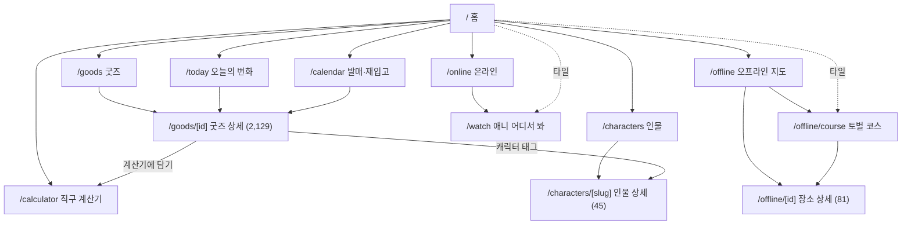
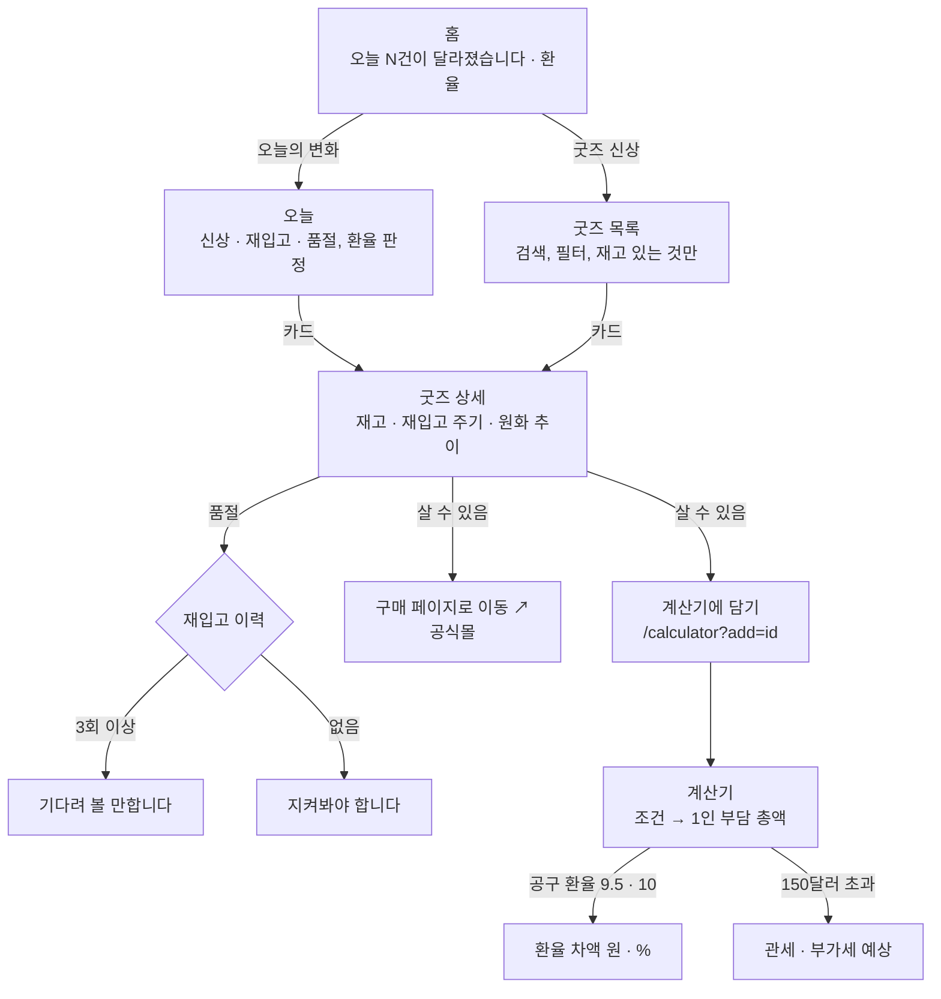
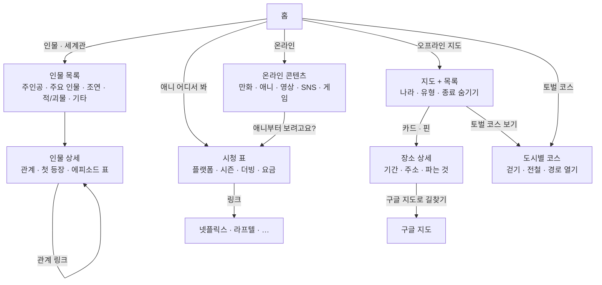
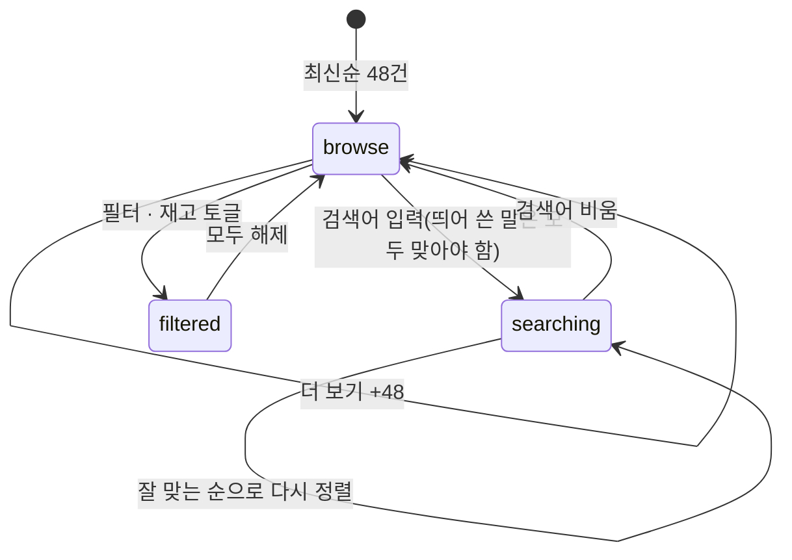
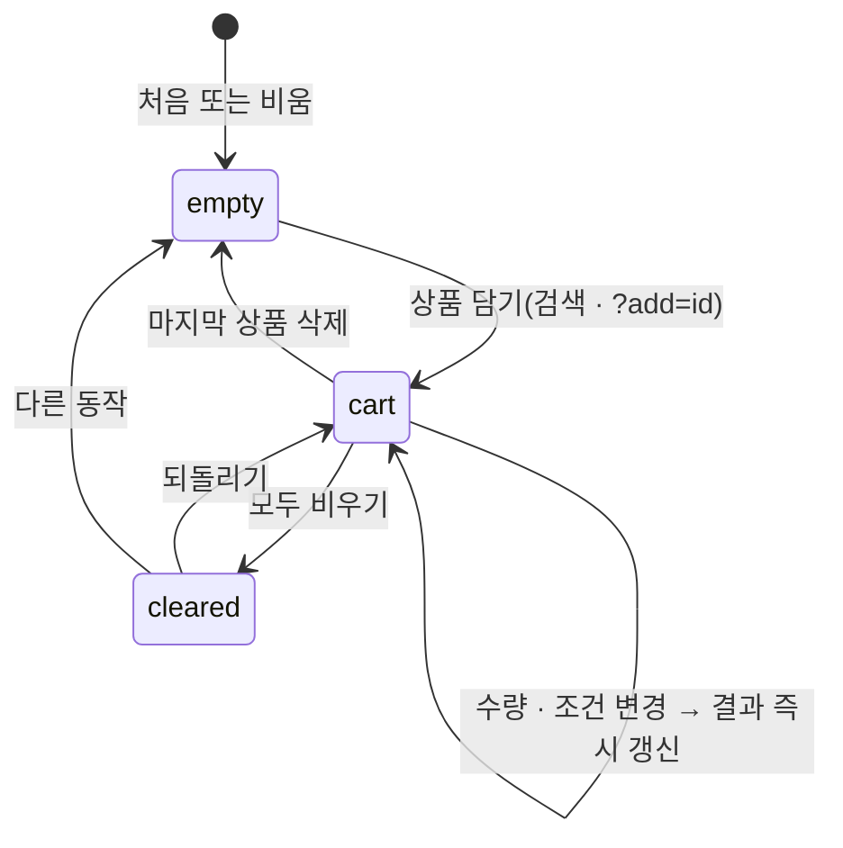

# 5. 정보구조와 사용자 흐름

> **구조:** 메뉴 여덟 개(홈, 오늘, 인물, 온라인, 오프라인, 캘린더, 굿즈, 계산기)에 메뉴 밖 페이지 둘(애니 어디서 봐, 토벌 코스), 상세 세 종류(굿즈, 인물, 장소). 매일 바뀌는 쪽(오늘·굿즈·캘린더·계산기)과 고정 정보 쪽(인물·온라인·오프라인)이 나뉘고, 홈 타일 여덟 개가 두 쪽을 한 번에 잇는다.

기준일 2026-11-11.

---

## 1. 사이트맵

사이드바(데스크톱)와 상단 메뉴(폰)는 모든 페이지에 같다: 홈, 오늘, 인물, 온라인, 오프라인, 캘린더, 굿즈, 계산기. 애니 어디서 봐와 토벌 코스는 메뉴에 없고 홈 타일과 상위 페이지의 안내 패널에서 들어간다. 검색 유입을 받는 페이지라 주소는 고정이다.

사이드바 아래에 커서 선택(치이카와·하치와레·우사기)이 있다. 사이트맵(`sitemap.xml`)에는 위 페이지 전부와 상세 2,255장이 들어간다.

## 2. 본 흐름: 이미 사고 있는 팬

## 3. 본 흐름: 막 입문한 팬

## 4. 굿즈 목록의 상태

검색어, 필터 네 개(캐릭터·분류·브랜드·나라, 여러 개 선택), 재고 토글, 보이는 건수(48씩)가 상태다. 전부 화면 메모리에만 있고 주소에 남기지 않는다. 검색어나 필터를 바꾸면 보이는 건수는 48로 돌아간다.

검색어 입력이 0.8초 멈추면 `goods_search` 이벤트를 한 번 보낸다. 결과가 0건이면 `goods_search_empty`도 보낸다.

## 5. 계산기의 상태

장바구니(상품·수량)와 조건(환율·해외배송비·인원·국내 택배비·품목)이 상태이며 둘 다 localStorage에 남는다. 실환율을 그대로 쓰고 있었으면 다음 방문에는 그날의 실환율로 바뀐다.

## 6. 분기

| 분기 | 조건 | 가는 곳 |
|---|---|---|
| 기록이 아직 없음 | history.days가 비어 있음 | 홈에 변화 패널 없음, 오늘은 "기록을 모으는 중입니다" |
| 환율 판정 불가 | 환율 기록 2일 미만 | 환율 패널 없음 |
| 발매 예정 없음 | 오늘 이후 발매일이 없음 | 캘린더 "다음 발매를 기다리는 중입니다" |
| 품절 상품의 계산기 담기 | 살 수 없음 또는 엔화 아님 | 버튼 자체가 없음 |
| `?add=` 상품이 후보에 없음 | 품절·한국 상품 | 담기지 않음, 계산기는 그대로 열림 |
| 검색 결과 0건 | 모든 말이 맞는 상품 없음 | "검색 결과가 없습니다"와 조건 풀기 안내, 이벤트 기록 |
| 코스가 없는 도시 | 장소 1곳뿐 | 코스 목록에서 제외 |
| 경유지 10곳 초과 | 큰 도시 | 앞 10곳만 구글 지도로, "앞 10곳만" 표시 |
| 이미지 없음·실패 | src 없음 또는 onError | 이모지 대체 |
| 없는 주소 | 정적 파일 없음 | 404, 홈으로 |

## 7. 모바일과 데스크톱의 차이

| 항목 | 모바일 | 데스크톱(1024px~) |
|---|---|---|
| 메뉴 | 상단바 + 메뉴 버튼(펼침) | 왼쪽 사이드바 고정 |
| 커서 선택 | 없음(터치에선 커서가 없다) | 사이드바 아래 |
| 홈 3D | 폭 좁으면 캐릭터 간격 2.9 | 간격 3.3 |
| 굿즈 카드 | 2열 | 4~5열 |
| 계산기 | 담기 → 조건 → 결과가 세로로, "결과 보기 ↓" 버튼이 결과로 스크롤 | 결과가 보이는 채로 |
| 지도 | 폭 가득, 핀 터치 | 같음 |
| 상품 사진 | 탭 | 올리면 옆에 크게(HoverZoom) |
