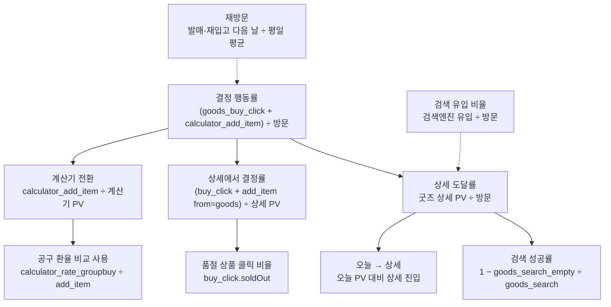

# 7. 지표와 이벤트 설계

> **북극성 지표:** 방문자 중 결정 행동(구매 링크 클릭 또는 계산기에 담기)을 한 비율. 사이트의 의도가 "살지 말지 정하게 돕는다"이기 때문이다. 검색 유입은 별도 축으로 본다. 데이터가 쌓일수록 좋아지는 사이트라 재방문도 같이 본다.

기준일 2026-11-11. 도구는 Vercel Web Analytics(쿠키 없음, 개인 식별 없음). 사용자 정의 이벤트는 Vercel Pro 이상에서만 대시보드에 보인다. Hobby인 지금은 보내지만 집계되지 않는다.

---

## 1. 지표 트리

## 2. 퍼널

| 단계 | 이벤트 또는 페이지뷰 | 보는 것 |
|---|---|---|
| 1 방문 | 페이지뷰 | 유입 경로(검색·직접·SNS), 첫 페이지(오늘·굿즈·계산기로 바로 들어오면 그게 이 사이트의 이유) |
| 2 탐색 | goods_search, goods_instock_filter | 무엇을 찾는지, 0건 검색어 |
| 3 상세 | /goods/[id] 페이지뷰 | 어떤 상품이 보이는지 |
| 4 결정 | goods_buy_click(soldOut), calculator_add_item(from) | 살 수 있는 상품 클릭과 품절 상품 클릭의 비율 |
| 5 계산 | calculator_rate_groupbuy, calculator_rate_market | 공구 비교가 실제 쓰임새인지 |

입문 쪽 퍼널은 따로 본다. 인물·온라인·오프라인 페이지뷰 → online_open / watch_open / place_directions / course_directions.

퍼널은 4주마다 본다. 결정 행동률이 10% 아래면 상세 화면(재입고 안내·구매 버튼 위치)을, 검색 성공률이 80% 아래면 사전과 별칭을 먼저 본다.

## 3. 이벤트 정의표

| 이벤트 | 언제 | 속성 | 쓰는 지표 |
|---|---|---|---|
| goods_search | 굿즈 검색어 입력이 0.8초 멈춘 뒤 | query | 무엇을 찾는지, 사전에 넣을 말 |
| goods_search_empty | 위와 같을 때 결과가 0건이면 | query | 검색 성공률 |
| goods_instock_filter | 재고 있는 것만 토글 | | 재고 필터 사용률 |
| goods_buy_click | 상세에서 구매·상품 페이지 링크 | id, brand, country, affiliate, soldOut | 북극성, 제휴 수익 상한 |
| calculator_add_item | 계산기에 상품을 담을 때 | from: goods(상세에서 넘어옴) 또는 없음(계산기 검색) | 북극성, 계산기 전환 |
| calculator_rate_groupbuy | 공구 환율 프리셋 | | 공구 비교 사용 |
| calculator_rate_market | 실환율로 되돌림 | | 위와 비교 |
| place_directions | 장소 상세 길찾기 | id, city | 오프라인 정보가 방문으로 이어지는지 |
| course_directions | 코스 경로 열기 | city | 코스 사용 |
| online_open | 온라인 콘텐츠 링크 | platform | 어떤 경로를 쓰는지 |
| watch_open | 애니 어디서 봐 링크 | platform | 플랫폼별 수요 |
| cursor_change | 커서 캐릭터 선택 | character | 재미 요소 사용 |
| hero_character_tap | 홈 3D 캐릭터 터치 | character | 재미 요소 사용 |

이벤트는 `src/lib/analytics.ts`의 `track()` 하나로 보낸다. 도구를 바꿔도 화면 코드는 그대로다. 외부 링크는 `TrackedLink` 컴포넌트에 `event`와 `props`만 주면 된다.

## 4. 검색엔진 쪽 지표

| 지표 | 어디서 | 보는 법 |
|---|---|---|
| 색인된 페이지 수와 제외 이유 | 구글 서치콘솔 색인 생성 > 페이지 | "크롤링됨 - 현재 색인이 생성되지 않음"이 많으면 페이지가 서로 비슷하다는 뜻 |
| 유입 검색어 | 서치콘솔 실적 > 검색어 | 여기 뜨는 말이 별칭 사전에 넣을 말 |
| 상품명 완전 한국어 비율 | 빌드 때 계산 | 69.2%(1,585/2,289, 2026-11-06). 검색어 데이터로 우선순위 |

## 5. 데이터 자체의 지표

사이트가 쌓는 데이터가 곧 가치라 데이터 지표도 본다. 전부 `history.json`과 `goods.json`에서 계산된다.

| 지표 | 2026-11-11 값 |
|---|---|
| 기록 일수 | 51일(2026-09-18부터) |
| 누적 변화 | 품절 719, 신상 348, 재입고 28 |
| 상품 수 / 살 수 있는 것 | 2,129 / 261 |
| 재입고 이력이 있는 상품 / 3회 이상 | 1,028 / 431 |
| 수집 실패로 비는 날 | 0 |

## 6. 판단 기준

- 계산기를 담기까지 가는 비율이 낮으면 상품 검색을 고치는 게 먼저다.
- 발매·재입고일에만 방문이 몰리고 평소에 없으면 알림(피드 구독)이 다음이다.
- 검색어에 특정 캐릭터나 시리즈가 반복되면 그 축으로 데이터를 더 채운다.
- 구매 클릭이 거의 없으면 제휴 가입은 뒤로 미룬다. 수익보다 트래픽이 먼저다.
- 사용자 정의 이벤트를 읽어야 할 만큼 유입이 생기면 Vercel Pro 또는 Umami 같은 무료 도구로 옮긴다. `track()` 한 곳만 바꾸면 된다.

## 7. 실험 후보

| 가설 | 바꾸는 것 | 보는 지표 |
|---|---|---|
| 재입고 안내가 있으면 품절 상품에서도 구매 페이지를 덜 누른다 | 없음(이미 있음) | buy_click.soldOut 비율 |
| 상세에서 바로 담은 사람이 계산을 끝까지 한다 | 없음(from 속성으로 분리) | from=goods vs 계산기 검색의 rate 칩 사용 |
| 오늘 페이지가 재방문을 만든다 | 홈 변화 패널 문구 | 오늘 PV의 요일별 분포 |
