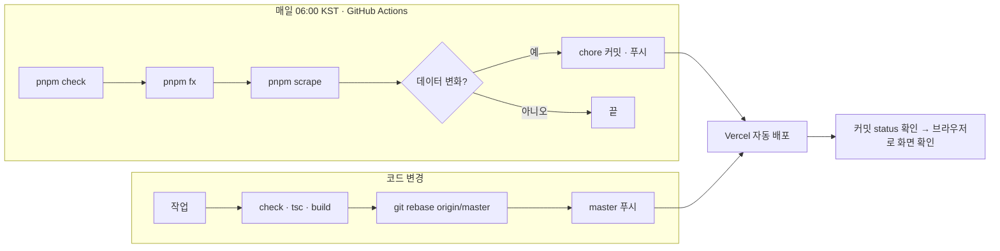

# 8. 출시·운영 계획

> **출시 기준:** 테스트 108개와 타입 검사, 정적 빌드(약 2,270장)가 통과하고, 폰과 데스크톱에서 홈 → 오늘 → 굿즈 → 상세 → 계산기까지 손으로 한 번 돌린 뒤 master에 푸시한다. 푸시하면 Vercel이 자동으로 배포한다. 데이터는 매일 06:00 KST에 GitHub Actions가 갱신하고, 변화가 있는 날만 커밋돼 같은 길로 배포된다.

기준일 2026-11-11.

---

## 1. 출시 전 확인

- [x] `pnpm check`(node --test 108개), `tsc --noEmit`, `pnpm build` 통과
- [x] 폰(390px)과 데스크톱(1280px)에서 홈 → 오늘 → 굿즈 검색 → 상세 → 계산기에 담기 → 결과까지 손으로 한 바퀴
- [x] 굿즈 상세의 구조화 데이터가 검색 결과 미리보기에서 값·재고를 보여 줌
- [x] 사이트맵 2,425개 URL, robots, manifest 생성
- [x] 구글·네이버 소유 확인과 사이트맵 제출(2026-11-06)
- [x] OG 이미지가 카카오톡·슬랙에서 뜸(절대 주소)
- [x] 수집 워크플로가 테스트 실패 시 멈추고, 변화 없는 날 커밋하지 않음
- [x] 연락처가 어느 페이지에도 없음
- [x] 비공식 팬 사이트 고지, 이미지 출처, 문의 경로가 사이트에 있음(셀프 리뷰 뒤 추가)

## 2. QA 시나리오

| ID | 시나리오 | 기대 결과 | 자동화 |
|---|---|---|---|
| Q-01 | 어제 있던 상품이 오늘 없음 / 그 반대 | 품절 / 재입고로 기록 | 단위(history.test) |
| Q-02 | 처음 보는 id인데 발매일 60일 초과 | 신상으로 세지 않음 | 단위 |
| Q-03 | 이전 목록이 비어 있음 | 변화 0건 | 단위 |
| Q-04 | 수집 응답에 엔이 아닌 가격 | 수집 중단, 커밋 없음 | 단위(lib.test) |
| Q-05 | "치이카와 인형" 검색 | 두 말 모두 맞는 상품만, 잘 맞는 순 | 단위(search.test) |
| Q-06 | 상품명 치환 | 한국어 옆 1~2글자 카나 조각 없음 | 단위(goods-name.test) |
| Q-07 | 150달러 경계 전후 장바구니 | 미만이면 세금 0, 초과면 전체 과세, 과세가격에 국제운임 포함 | 단위(cost.test) |
| Q-08 | 무배컷 미달 | 일본 내 배송료 990엔 추가, 면세 판정 물품가격에 포함 | 단위 |
| Q-09 | 인원 0명 | 1명으로 계산 | 단위 |
| Q-10 | 재입고 0·1·3회 상품 | 안내 문장 세 단계 | 단위(restock.test) |
| Q-11 | 발매일이 내일인 상품 | "발매 예정", 품절 아님 | 단위(stock.test) |
| Q-12 | 장소 1곳뿐인 도시 / 1.8km 초과 구간 | 코스 없음 / 전철 표시 | 단위(course.test) |
| Q-13 | 환율 기록에서 오늘이 가장 쌈 | "기록한 날 중 가장 쌉니다" | 단위 |
| Q-14 | 이미지 주소에 width 파라미터 | 1배·2배 srcset | 단위(image.test) |
| Q-15 | 3D 캐릭터 동작 범위 | 귀·팔 각도가 한계 안 | 단위(motions.test) |
| Q-16 | 계산기 `?add=품절상품` | 담기지 않음, 오류 없음 | 수동 |
| Q-17 | 장바구니 저장 뒤 재방문 | 상품·조건 복원, 실환율은 그날 값 | 수동 |
| Q-18 | 폰에서 지도·3D | 스크롤 막힘 없음, 메뉴 전환 | 수동 |
| Q-19 | `prefers-reduced-motion` | 3D 정지 | 수동(`?still`로 재현) |
| Q-20 | 피드(feed.xml) | 최근 변화가 날짜별 항목으로, 변화 없는 날은 빠짐 | 단위(feed.test) |

## 3. 릴리즈 절차

- 커밋은 `type : 설명` 형식. 데이터 갱신은 `chore`, 기능은 `feat`, 수정은 `fix`, 문서는 `docs`.
- 푸시 전 `git fetch && git rebase origin/master`. 매일 데이터 커밋이 올라오므로 자주 필요하다.
- 배포 확인은 `gh api repos/OHaEuN/chiikawaFinder/commits/<sha>/status`로 Vercel 상태를 기다린 뒤 브라우저로 본다. 사이트를 curl로 반복 호출하면 봇 차단에 걸린다.
- 환경 변수는 Vercel에 검색엔진 소유 확인 토큰 둘(`NEXT_PUBLIC_GOOGLE_VERIFICATION`, `NEXT_PUBLIC_NAVER_VERIFICATION`). 넣거나 바꾸면 재배포.
- 수동 데이터(장소·온라인·인물·한국 상품)는 출처와 함께 JSON을 고쳐 코드와 같은 길로 올린다.

## 4. 모니터링

| 무엇 | 어디서 | 주기 |
|---|---|---|
| 수집 성공 여부 | GitHub Actions 실행 결과(실패 시 기본 메일) | 매일 |
| 그날 변화 건수 | 오늘 페이지, Actions 로그의 "변화: 신상 N · 품절 N · 재입고 N" | 매일 |
| 방문자·페이지뷰·유입 경로 | Vercel Web Analytics | 주 1회 |
| 색인·검색어 | 구글 서치콘솔, 네이버 서치어드바이저 | 주 1회 |
| 공식몰 구조 변경 | 수집 테스트 실패 또는 변화 0건이 며칠 이어짐 | 그때 |
| 장소 기간 만료 | 오프라인 페이지 "종료" 전환 | 월 1회 새 팝업 추가 |

## 5. 리스크

| 리스크 | 영향 | 가능성 | 대응 |
|---|---|---|---|
| 공식몰 API 구조 변경·차단 | 수집 중단 | 중간 | 테스트가 수집 단계에서 막음. 전날 데이터로 서비스 유지. UA 고정, 하루 1회로 부담 최소 |
| 저작권·상표 이의 | 자료 삭제 요구 | 낮음 | 비공식 고지, 이미지 직링크, 요청 시 즉시 삭제 |
| 가품·공구 사기에 연루 | 신뢰 하락, 분쟁 | 낮음 | 판별·개별 공구를 만들지 않음. 플랫폼 보호 수준만 안내 |
| 세금 계산이 실제와 다름 | 사용자 손해 | 중간 | 예상치 고지, 근거 문서, 품목 사용자 선택, 합산 과세 가능성 명시 |
| 하루 한 번이라 변화를 놓침 | 신뢰 하락 | 높음 | 확인 시각 명시, 실시간 약속 안 함 |
| 상품명 번역이 어색하거나 틀림 | 검색 실패 | 중간 | 원문 병기, 검색어 데이터로 사전 보강, 조각 검사 테스트 |
| Vercel Hobby 비상업 조건 | 서비스 중단 | 낮음(수익 전) | 수익이 붙으면 Pro나 다른 정적 호스팅으로. 정적 파일이라 종속 없음 |
| 사용자 정의 이벤트를 못 읽음 | 지표 공백 | 확정 | 페이지뷰로 대체. 유입이 생기면 도구 전환 |
| 수동 데이터가 낡음 | 틀린 장소·링크 | 중간 | 월 1회 점검, 출처 링크로 확인 |

## 6. 로드맵

실제로 한 일은 [서비스 기획서 9절](./02-service-plan.md#9-실제-진행)에 있다. 앞으로는 지표를 본 뒤 정한다.

| 단계 | 조건 | 할 일 |
|---|---|---|
| 지금 | 출시됨, 색인 진행 중 | 서치콘솔 검색어를 사전에 반영. 피드 구독 안내 |
| 다음 | 검색 유입이 잡히면 | 0건 검색어로 별칭 보강, 상품명 한국어 비율 80% |
| 다음 | 발매·재입고일 재방문이 확인되면 | 피드를 캐릭터·분류별로 나누기 |
| 다음 | 구매 클릭이 월 수백 건이 되면 | 쿠팡 파트너스·네이버 쇼핑커넥트로 한국 상품 제휴 |
| 이후 | 한국 상품 수요가 보이면 | 대원미디어·CGV·편의점 콜라보 수동 데이터 확충 |
| 이후 | 팝업 정보 수요가 보이면 | 입장 방식(예약·현장) 필드 추가 |
